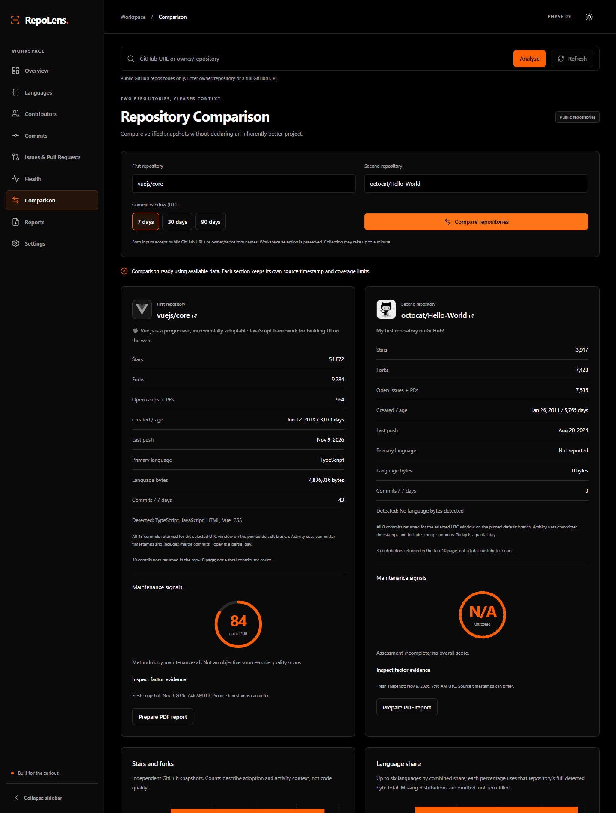

# RepoLens

**Understand public GitHub repositories through source-linked analytics.**

RepoLens combines repository metadata, language and contributor charts, bounded commit activity, separate issue/PR analytics, transparent maintenance signals, side-by-side comparison, and PDF reports. Every metric comes from GitHub; unavailable evidence stays unavailable.



[API reference](documentation/API.md) ? [Architecture](documentation/ARCHITECTURE.md) ? [Deployment](documentation/DEPLOYMENT.md) ? [Security](SECURITY.md) ? [Sample PDF](documentation/reports/phase-9-vuejs-core.pdf)

## Features

- Overview with canonical identity, topics, license, dates, and GitHub statistics.
- Responsive language and top-contributor charts, with accessible tabular alternatives.
- Default-branch commit history with filtering and 7/30/90-day UTC windows.
- Separate issue and pull-request queues, pagination, filters and scoped counts.
- Explainable maintenance assessment with factor rules, evidence and suggestions.
- Two-repository comparison with independent errors and explicit data coverage.
- Embedded-font, vector-chart PDF reports from immutable server-held snapshots.
- Black, white and jet-orange themes; keyboard navigation, mobile drawer, skeletons and page recovery.

**Stack:** React, Vite, strict TypeScript, Tailwind CSS 4, React Router, Recharts, Lucide; FastAPI, Pydantic, HTTPX, ReportLab; Vitest, Testing Library, Pytest and PDF inspection tools.

## Quick start

Requires **Node.js 22.12+** (24 recommended), npm and **Python 3.11+** (CI uses 3.12). From the repository root in PowerShell:

```powershell
# Skip virtual-environment creation if the existing one is working.
python -m venv backend/venv
.\backend\venv\Scripts\python.exe -m pip install -r backend/requirements-dev.txt
npm ci --prefix frontend
```

On macOS/Linux, substitute `backend/venv/bin/python` for the PowerShell Python path. Runtime-only installs can use `backend/requirements.txt` instead.

Optional environment configuration: copy `backend/.env.example` to `backend/.env` and `frontend/.env.example` to `frontend/.env.local` **only if the local files do not already exist**. Defaults work without either file. Never overwrite an existing token configuration.

| Variable | Location | Meaning |
| --- | --- | --- |
| `GITHUB_TOKEN` | Backend runtime only | Optional token for public read access; never expose in frontend variables |
| `CORS_ORIGINS` | Backend runtime | Comma-separated exact frontend origins; defaults to local port 5173 |
| `VITE_API_BASE_URL` | Frontend build/dev | Public API URL, defaults to `http://127.0.0.1:8000`; restart/rebuild after changes |

Terminal 1:

```powershell
.\backend\venv\Scripts\python.exe -m uvicorn main:app --app-dir backend --reload --host 127.0.0.1 --port 8000
```

Terminal 2:

```powershell
npm run dev --prefix frontend
```

Open **http://127.0.0.1:5173**; backend Swagger UI: **http://127.0.0.1:8000/docs**. Search `vuejs/core`, `octocat/Hello-World`, or a full public GitHub repository URL. GitHub redirects are resolved to canonical names. Rate limits produce a retry countdown without automatic retries.

## Testing and production build

```powershell
.\backend\venv\Scripts\python.exe -m pytest backend/tests -q
npm test --prefix frontend
npm run build --prefix frontend
npm run preview --prefix frontend
```

Preview is a local check of `frontend/dist`, not a production web server. Tests use deterministic synthetic fixtures; application analytics always come from GitHub. Vitest includes DOM keyboard/recovery tests; Pytest covers API errors, coverage limits, public-only access, scoring, pagination, snapshots and PDF validity/layout.

Optional browser verification requires Edge (or set `BROWSER_EXECUTABLE_PATH`), free ports 5178/8000 and temporary Playwright:

```powershell
npm install --prefix "$env:TEMP/repolens-browser-review" playwright --no-package-lock --ignore-scripts --no-audit --no-fund
$env:PLAYWRIGHT_MODULE="$env:TEMP/repolens-browser-review/node_modules/playwright"
# Build first. This checks production-preview routes and controlled errors without GitHub quota.
node frontend/scripts/verify-production.cjs
# Optional live GitHub checks consume quota:
node frontend/scripts/verify-comparison-reports.cjs
```

GitHub Actions runs frontend tests/build, backend tests, and Docker build/start/health/deep-link checks on pushes and pull requests. Dependabot proposes dependency updates. CI uses no GitHub analytics token and does not publish or deploy.

## Project structure

```text
.github/                    CI and dependency-update configuration
backend/
  main.py                   API entry point, GitHub client, overview analytics
  commit_history.py         Commit normalization and UTC aggregation
  work_items.py             Issue/PR pagination, scoped counts and caching
  health_api.py             Maintenance evidence collection
  health_scoring.py         Pure documented scoring rules
  snapshot_api.py            Immutable comparison/report snapshots
  pdf_reports.py            PDF typography, vector charts and source links
  tests/                    Pytest unit, API, security and PDF tests
  Dockerfile, .env.example, requirements*.txt
frontend/
  src/
    app/                    Router and navigation
    components/             Shell, primitives, recovery and analytics charts
    hooks/                  Repository state, theme and request lifecycle
    pages/                  Nine application pages
    services/               API clients, runtime schemas and transformations
    styles/                 Global approved palette and responsive tokens
    types/                  Strict API interfaces
  scripts/                  Optional reproducible browser verification
  Dockerfile, .env.example, package*.json, vite.config.ts
deploy/nginx.conf           Static hosting, SPA fallback and API proxy
documentation/              API, architecture, methodology, audit and samples
compose.yaml                Local container stack
.dockerignore, .gitignore, .env.example, SECURITY.md
```

## Git initialization and publishing

No commit or push is performed automatically. The supplied working directory may already contain `.git`; run `git init` only for a new checkout without it. Create an empty GitHub repository first, then replace placeholders:

```powershell
git init
git status --short
# Confirm secrets and generated files are ignored before staging.
git check-ignore backend/.env frontend/.env.local
git add .
git diff --cached --stat
# Review staged content before committing.
git diff --cached --check
git commit -m "Build RepoLens public GitHub analytics platform"
git branch -M main
git remote add origin https://github.com/YOUR_USERNAME/RepoLens.git
git push -u origin main
```

If `origin` already exists, inspect it with `git remote -v` rather than adding it again. Enable branch protection and require CI checks after the first successful run. Choose a license explicitly before distributing the project; this repository does not assume a license grant.

## Deployment

The supplied **Docker Compose + Nginx + single-worker FastAPI** stack is the recommended starting point. Configure the root `.env.example` values through a local `.env` or host environment; never build tokens into images.

```powershell
docker compose config --quiet
docker compose build
docker compose up -d --wait
```

Open http://localhost:8080. For public hosting, use an HTTPS domain, build with that public API URL, configure exact CORS origins, and place the localhost-bound proxy behind a TLS ingress. Static hosting plus a separate API is also possible with SPA rewrites. See [deployment details and operational limits](documentation/DEPLOYMENT.md), following the [Vite deployment guidance](https://vite.dev/guide/static-deploy) and [FastAPI container guidance](https://fastapi.tiangolo.com/deployment/docker/).

## Known limitations and future improvements

- GitHub quotas and availability govern freshness; separate endpoints are not an atomic snapshot.
- Commit retrieval is bounded to 500 commits. Incomplete ranges have no historical chart; contributor analytics cover a top-10 sample, not everyone.
- Combined `open_issues_count` includes PRs. Separate summaries disclose incomplete GitHub search data.
- Maintenance health is an explainable heuristic, **not an objective source-code quality score**. Missing factors prevent an overall score.
- Report snapshots expire after five minutes and are process-local. Use one worker/replica until shared storage is implemented; restarts invalidate IDs.
- PDF fonts substitute unsupported characters with visible Unicode notation. Very long commit subjects are explicitly shortened.
- No accounts, saved repository preferences, background polling, or distributed abuse controls. Add shared caching, per-user quotas, authenticated access, observability and load tests before expanding a public deployment.
- Browser audits cover representative widths and workflows, not a formal WCAG certification. Container execution and hosted CI still require a running Docker engine/GitHub runner.

Suggested next improvements: shared Redis snapshots, stronger quota/concurrency controls, broader contributor pagination, accessible chart summaries, localization and full browser automation in CI. See [Phase 10 review](documentation/PRODUCTION_REVIEW.md) for actual verification results and scope.
